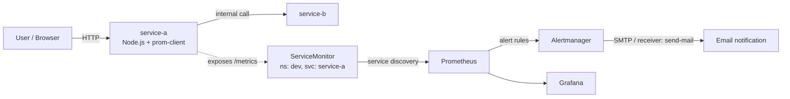
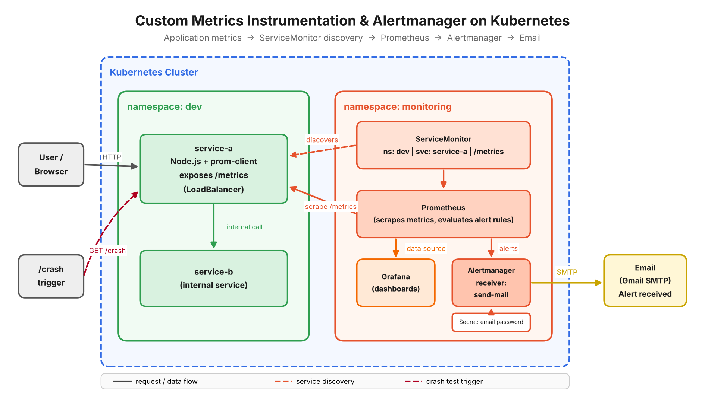
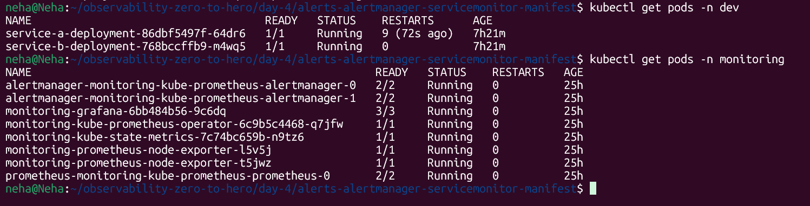
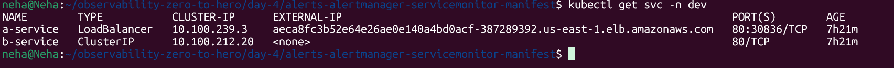
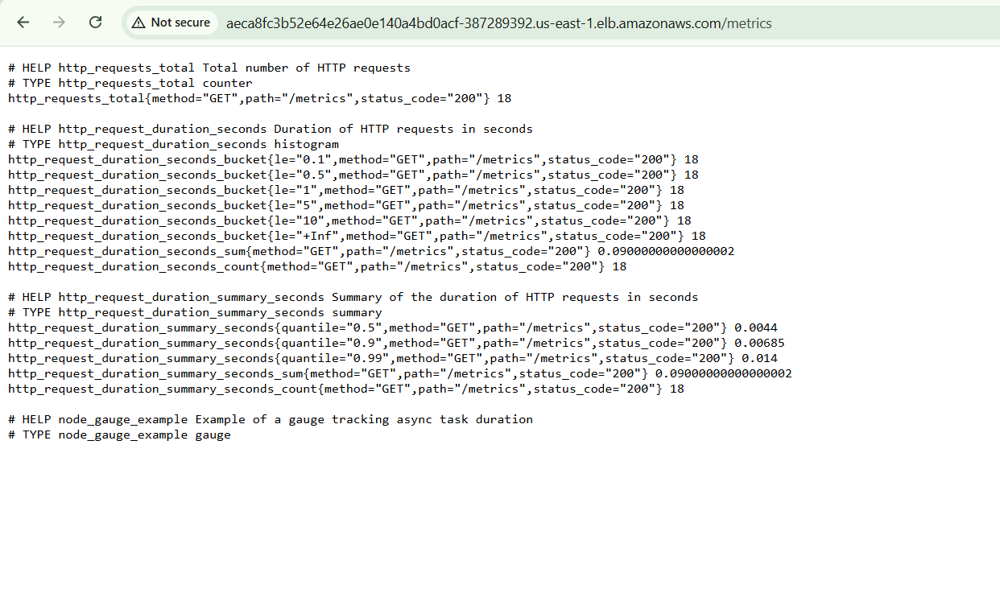
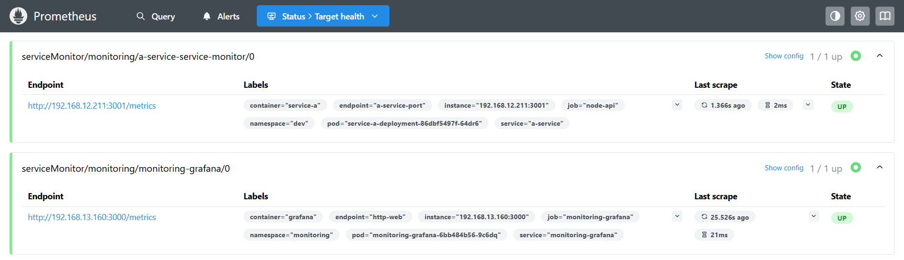
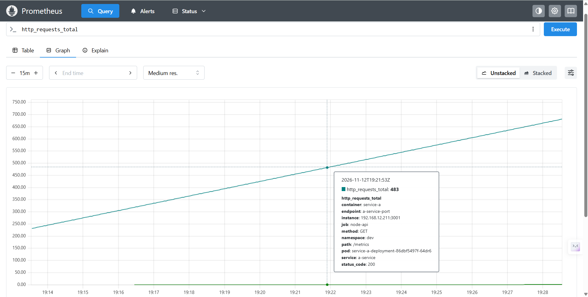
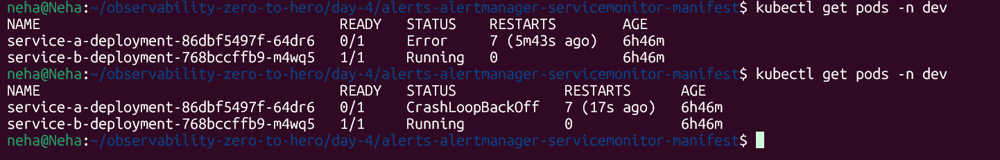
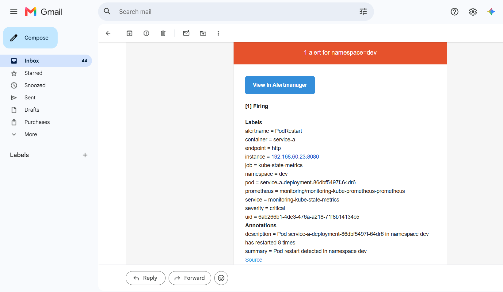

# Custom Metrics Instrumentation & Alertmanager on Kubernetes

Hands-on project showing how to instrument a Node.js application with custom Prometheus metrics, get those metrics scraped on Kubernetes using a `ServiceMonitor`, and fire real-time email alerts with Alertmanager.


---

## Table of Contents

1. [Project Overview](#1-project-overview)
2. [What I Learned](#2-what-i-learned)
3. [Why Instrumentation Matters](#3-why-instrumentation-matters)
4. [Architecture](#4-architecture)
5. [Metric Types](#5-metric-types)
6. [Tech Stack](#6-tech-stack)
7. [Repository Structure](#7-repository-structure)
8. [Prerequisites](#8-prerequisites)
9. [Setup Guide](#9-setup-guide)
10. [Verifying Custom Metrics in Prometheus](#10-verifying-custom-metrics-in-prometheus)
11. [Configuring Alertmanager](#11-configuring-alertmanager)
12. [Testing the Alert](#12-testing-the-alert)
13. [Troubleshooting](#13-troubleshooting)
14. [Screenshots](#14-screenshots)
15. [Security Notes](#15-security-notes)
16. [Cleanup](#16-cleanup)

---

## 1. Project Overview

Monitoring tools like Prometheus and Grafana are only useful if applications actually expose data. This project covers the full path from application code to alert notification:

| # | Goal |
|---|------|
| 1 | Understand what instrumentation is and why exporters alone are not enough |
| 2 | Instrument a Node.js microservice with custom metrics using `prom-client` |
| 3 | Deploy the Prometheus stack on Kubernetes with Helm |
| 4 | Make Prometheus discover the app using a `ServiceMonitor` |
| 5 | Configure Alertmanager to send an email when a pod crashes or restarts |

---

## 2. What I Learned

- What instrumentation is (writing metrics, logs and traces into the application)
- Why exporters (Node Exporter, MySQL Exporter) cannot provide application-specific data
- The four Prometheus metric types and when to use each
- How `prom-client` exposes a `/metrics` endpoint in Prometheus format
- How Prometheus service discovery works in Kubernetes via `ServiceMonitor`
- How to deploy manifests with Kustomize (`kubectl apply -k .`)
- How to configure Alertmanager receivers, store credentials in a Kubernetes Secret, and trigger a real alert

---

## 3. Why Instrumentation Matters

**Instrumentation** is the process of writing metrics, logs, or traces into the application itself. Without it, even a perfect observability stack has nothing application-specific to show.

### Why exporters are not enough

Exporters are plug-ins built for one specific job:

| Exporter | What it provides |
|----------|------------------|
| Node Exporter | CPU, memory and disk utilization of Kubernetes nodes |
| MySQL Exporter | Database-related metrics |

Exporters **cannot** answer application-specific questions such as:

| Need | Example |
|------|---------|
| User activity | How many users logged in during the last 30 days? |
| Business events | How many accounts were created in the last 30 days? |
| Performance | What is the HTTP request duration of one particular service? |

For these, the application must be instrumented.

### Who does the instrumentation?

It depends on the organization: developers, platform engineers, or SREs. DevOps/SRE engineers typically set up Prometheus, Grafana, dashboards and alerts, while developers provide the metrics, logs and traces.

---

## 4. Architecture



---


*End-to-end flow: user traffic to service-a, ServiceMonitor discovery, Prometheus scraping, and Alertmanager email alerts.*

---

**Flow summary**

1. `service-a` records metrics using `prom-client` and exposes them at `/metrics`.
2. The `ServiceMonitor` tells Prometheus to scrape `service-a` in the `dev` namespace.
3. Prometheus evaluates alert rules (high CPU, pod restarts).
4. Alertmanager routes firing alerts to the `send-mail` receiver, which sends an email.

> `service-a` is exposed as a `LoadBalancer` service because it is accessed through the UI. Communication between `service-a` and `service-b` is internal.

---

## 5. Metric Types

Just like programming languages have data types, Prometheus has metric types because not every metric can be represented the same way.

| Type | Behavior | Examples |
|------|----------|----------|
| **Counter** | Only goes up, never down | Logins, accounts created, HTTP requests received |
| **Gauge** | Goes up and down | CPU usage, memory usage, number of ConfigMaps |
| **Histogram** | Records values into buckets | HTTP request duration / latency |
| **Summary** | Similar to histogram at a basic level | OpenTelemetry related |

**Rule of thumb:** always incrementing → Counter; increments and decrements → Gauge; need buckets (durations) → Histogram.

### Metrics instrumented in `service-a`

| Metric | Type | Why |
|--------|------|-----|
| `http_requests_total` | Counter | A received request can never be "un-received" |
| `http_request_duration_seconds` | Histogram | Durations need buckets: 0.5s, 1s, 5s, 10s |

### How histogram buckets work

If a request takes 5 ms it lands in the 5 ms bucket, a 10 ms request in the 10 ms bucket, and so on. When someone asks "how many requests were faster than X", you read that bucket. A counter or gauge cannot answer this.

---

## 6. Tech Stack

| Area | Tool |
|------|------|
| Application | Node.js, `prom-client` |
| Orchestration | Kubernetes |
| Packaging / deployment | Helm, Kustomize |
| Monitoring | Prometheus (kube-prometheus-stack) |
| Alerting | Alertmanager |
| Visualization | Grafana |
| Notification | Gmail SMTP (app password) |

---

## 7. Repository Structure

```
.
├── README.md
├── .gitignore
├── application/
│   ├── service-a/          # Node.js app with prom-client (index.js)
│   └── service-b/
├── k8s-manifests/          # Deployments and Services (Kustomize)
│   └── kustomization.yaml
├── alertmanager/
│   ├── alertmanager-config.yaml
│   ├── service-monitor.yaml
│   ├── email-secrets.example.yaml   # placeholders only, never real credentials
│   └── kustomization.yaml
├── screenshots/

```

---

## 8. Prerequisites

- A running Kubernetes cluster (minikube, kind, or a cloud cluster)
- `kubectl` configured for the cluster
- `helm` installed
- A Gmail account with **2-Step Verification** enabled (needed for an app password)
- Docker images for `service-a` and `service-b` (build your own or use the images listed in the source README)

---

## 9. Setup Guide

### Step 1: Install the Prometheus stack

The stack provides Prometheus, Alertmanager and Grafana in the `monitoring` namespace.

```bash
helm repo add prometheus-community https://prometheus-community.github.io/helm-charts
helm repo update

helm install prometheus prometheus-community/kube-prometheus-stack \
  -n monitoring --create-namespace
```

If Helm reports the release is already in use, uninstall it and install again:

```bash
helm uninstall prometheus -n monitoring
```

Verify:

```bash
kubectl get pods -n monitoring
```

### Step 2: Expose the Prometheus UI

Service names depend on your Helm release name; check with `kubectl get svc -n monitoring`.

```bash
kubectl port-forward svc/prometheus-kube-prometheus-prometheus 9090:9090 -n monitoring
```

Open `http://localhost:9090`.

### Step 3: Deploy the application

```bash
kubectl create namespace dev
kubectl apply -k k8s-manifests/
kubectl get pods -n dev     # wait for service-a and service-b to be Running
kubectl get svc -n dev      # LoadBalancer may take time to get an external IP
```

### Step 4: Explore the application

| Endpoint | Purpose |
|----------|---------|
| `/healthy` | Health check |
| `/metrics` | Metrics in Prometheus format |
| `/logs` | Sample log output |
| server error / not found routes | Generate error traffic |
| `/crash` | Intentionally crashes the app (used for the alert test) |

Generate some traffic so the metrics have data.

---

## 10. Verifying Custom Metrics in Prometheus

### The problem: empty results

Querying `http_requests_total` right after deploying returns **nothing**. The app is instrumented and Prometheus is running, but Prometheus does not know which applications to scrape. This is a **service discovery** problem.

### The fix: ServiceMonitor

A `ServiceMonitor` is a custom resource that tells Prometheus where to fetch metrics.

| Field | Value |
|-------|-------|
| Namespace | `dev` |
| Service to match | `service-a` |
| Endpoint | `/metrics` |

```bash
kubectl apply -f alertmanager/service-monitor.yaml
```

Wait about 2 minutes, set the graph time range to 1m, then re-run:

```promql
http_requests_total
http_request_duration_seconds_bucket
```

### The three-step process

| Step | Action |
|------|--------|
| 1 | **Instrument** the application with the right metric types |
| 2 | **Set up** Prometheus (Prometheus, Alertmanager, Grafana via Helm) |
| 3 | **Service discovery** with a ServiceMonitor |

---

## 11. Configuring Alertmanager

The configuration defines **what to alert on** (high CPU usage, pod restarts/crashes) and **where to send alerts** (receiver `send-mail`, via email).

### 11.1 Create a Gmail app password

1. Open your Google Account → **Manage your Google Account**.
2. Search for **App passwords**.
3. If it is missing, enable **2-Step Verification** first.
4. Create an app password named `alertmanager` and copy it.

### 11.2 Store the password as a Kubernetes Secret

Encode the password in base64:

```bash
echo -n "YOUR_APP_PASSWORD" | base64
```

Copy `email-secrets.example.yaml` to `email-secrets.yaml` and paste the encoded value in place of the placeholder.


### 11.3 Update the Alertmanager config

Replace the placeholder email address(es) in the Alertmanager configuration with your own.

### 11.4 Apply

```bash
cd alertmanager/
kubectl apply -k .
```

> During the first ServiceMonitor apply, the Alertmanager part may fail because it is not fully configured yet. Re-apply after updating the secret and email settings.

---

## 12. Testing the Alert

1. Hit the `/crash` endpoint of `service-a`.
2. Watch the pod restart:

   ```bash
   kubectl get pods -n dev -w
   ```

3. After the crash (and again about 20 seconds later on repeat crashes), Alertmanager sends a **pod restart** notification to the configured email.

### Evidence

| Check | Screenshot |
|-------|------------|
| `http_requests_total` in Prometheus | `screenshots/http_requests_total.png` |
| Histogram buckets graph | `screenshots/histogram.png` |
| Pod restart count | `screenshots/pod_restarts.png` |
| Alert email received | `screenshots/alert_email.png` |

---

## 13. Troubleshooting

| Problem | Cause | Solution |
|---------|-------|----------|
| `http_requests_total` returns nothing | No ServiceMonitor, Prometheus does not know the app | Apply the ServiceMonitor and wait ~2 minutes |
| Graph looks empty | Time range too wide for a freshly deployed app | Set range to 1m |
| Helm says release is still in use | Existing release with the same name | `helm uninstall` then reinstall |
| `kubectl apply` fails on the Alertmanager config | Secret/config not yet updated | Update secret and email, apply again |
| LoadBalancer has no external IP | Takes time or unsupported locally | Wait, or use `kubectl port-forward` / `minikube tunnel` |
| No alert email | Wrong app password, 2FA not enabled, or wrong receiver email | Regenerate app password, recheck secret and config |

---

## Screenshots

### 1. Deployment

| Pods running in `dev` and `monitoring` | `service-a` exposed as LoadBalancer |
|:---:|:---:|
|  |  |

*All pods in `Running` state, and `service-a` exposed through a LoadBalancer service.*

---

### 2. Application Metrics Endpoint


*Raw metrics exposed by `service-a` at `/metrics` in Prometheus format.*

---

### 3. Service Discovery with ServiceMonitor


*Status → Targets page showing `service-a` as UP after applying the ServiceMonitor.*


*`http_requests_total` returning data in Prometheus. Before the ServiceMonitor was applied, this query returned nothing.*

---

### 4. Custom Histogram Metric


*`http_request_duration_seconds_bucket` showing request durations grouped into histogram buckets.*

---

### 5. Alerting


*Pod restart count increasing after hitting the `/crash` endpoint.*


*Email notification received from Alertmanager after the pod crashed.*

## 15. Security Notes

- `email-secrets.yaml` contains a credential. Base64 is **encoding, not encryption**; anyone can decode it.
- Only `email-secrets.example.yaml` (placeholders) is committed.
- Do not commit real email addresses if you want to keep them private.
- If a secret was ever committed, **revoke the app password** in your Google Account and generate a new one, since git history keeps old versions.
- For production, use a proper secrets solution (Sealed Secrets, External Secrets, Vault) instead of plain Kubernetes Secrets in Git.

---

## 16. Cleanup

```bash
kubectl delete -k k8s-manifests/
kubectl delete namespace dev
helm uninstall prometheus -n monitoring
kubectl delete namespace monitoring
```
---

**Author:** `Neha V M` | [GitHub](https://github.com/Neha-V-M) | [LinkedIn](https://linkedin.com/in/neha-v-m/)
